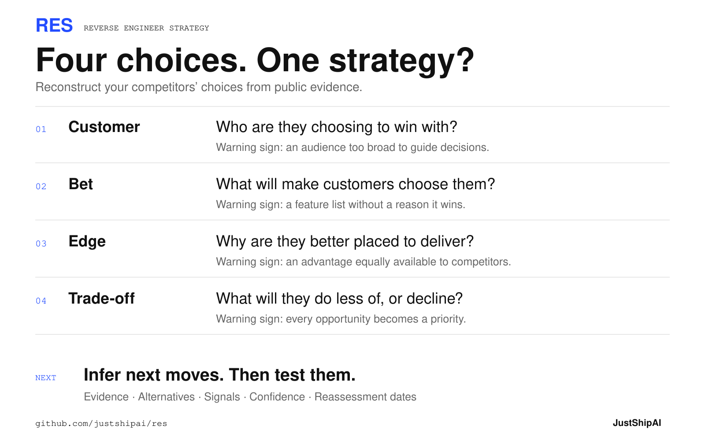
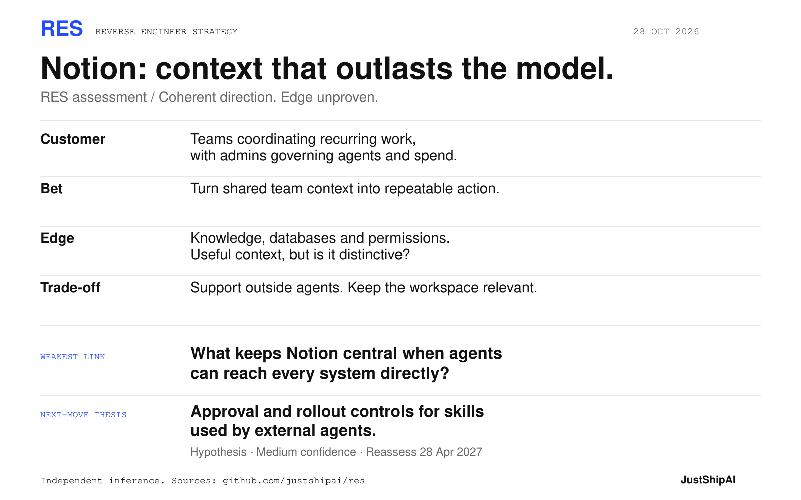

# Reverse Engineer Strategy

**RES**

**Reverse engineer your competitors’ strategy from what they ship.**

Give RES a competitor. It investigates their releases, documentation, pricing and public communications to uncover who they're targeting, the bets they're making, where their strategy is vulnerable and what they might do next.

Use it to understand a competitor's direction, investigate a suspected shift or turn scattered announcements into a clear strategic assessment.

RES separates evidence from inference, challenges its conclusions and makes uncertainty visible.

[Get started](#get-started) · [The four tests](#the-four-tests) · [Forecasts](#what-could-come-next) · [Notion example](#example-notion) · [Read the skill](SKILL.md)

---

## The four tests

A strategy should make four choices clear. RES tests each against what the company actually does.



[Download PNG](assets/res-framework.png) · [Editable SVG](assets/res-framework.svg)

| Test | The question | The warning sign |
| --- | --- | --- |
| **Customer** | Who are they choosing to win with? | An audience too broad to guide decisions. |
| **Bet** | What will make those customers choose them? | A feature list with no explanation of why it wins. |
| **Edge** | Why are they particularly well placed to deliver? | An advantage equally available to competitors. |
| **Trade-off** | What are they choosing to do less of, or decline? | Every opportunity becomes a priority. |

The useful part is the gap between the story and the decisions. A company can explain its strategy beautifully while its releases, pricing and priorities tell a different story.

## Get started

Install with the [skills CLI](https://skills.sh/docs/cli):

```bash
npx skills add justshipai/res
```

Choose your agent when prompted. Installation checked in a clean project for Codex with `skills` 1.7.4 on 28 October 2026. Then ask:

```text
Use RES to reverse engineer Linear's strategy over the past six months.
```

Or give a more specific question:

```text
Use RES to assess whether Notion's recent releases reinforce a coherent
strategy. Where are its customer choices and trade-offs least convincing?
```

For an agent without a skill installer, give it [SKILL.md](SKILL.md) and ask it to follow the instructions. It needs web search or browsing access to research current evidence.

RES is an instruction-based skill. No API keys, server or custom runtime required. Your agent's normal usage costs still apply.

## What you get

- **A strategic thesis:** the choices that best explain the company's actions.
- **Four evidence-backed tests:** inferred choices, dated sources, alternative explanations and confidence.
- **A candid verdict:** whether the choices reinforce one another, the weakest link and its consequence.
- **Likely next moves:** testable theses with supporting evidence, alternatives, confidence, confirming and disconfirming signals, and a reassessment date.

Run it again with the earlier report to see which conclusions changed and which predictions held up. RES reviews the evidence; it does not monitor companies automatically or assume access to previous reports.

## What could come next?

RES looks for unfinished sequences, newly enabled capabilities and pressures that could force a choice. It offers up to three specific theses, with an alternative, evidence that would strengthen or weaken each, and a date to reassess. It can return fewer when evidence is thin.

Likely behaviour and good strategy are separate judgements. A predicted move can be a poor decision. Already-announced plans are labelled as such, not passed off as predictions.

On a later run, give RES the earlier report. It preserves the original theses and marks them **supported, weakened, contradicted or unresolved**, rather than rewriting them to fit events. These are qualitative judgements, not calibrated probabilities.

## Example: Notion

*RES run on 28 October 2026. Research period: 28 April–28 October 2026. This is an independent assessment of public evidence, not Notion's endorsement.*



[Download PNG](assets/res-notion-example.png) · [Editable SVG](assets/res-notion-example.svg)

**Thesis: Notion is positioning its workspace as the persistent context and coordination layer for AI work, even when someone else's agent does the execution.** Overall confidence: **medium-high on direction, lower on competitive advantage**.

### Customer

**Choice:** Teams coordinating recurring knowledge work, with admins who need control over agents and spend. The [5 May release](https://www.notion.com/releases/2026-05-05) added agent creation controls, credit limits and usage dashboards. Current [Business and Enterprise packaging](https://www.notion.com/pricing) reinforces that buyer.

**Challenge:** This is clearer as a workflow segment than an industry focus; Notion still serves a broad audience. **Confidence: high** on team orientation, lower on a narrow priority segment.

### Bet

**Choice:** Turn team context into repeatable action. The sequence runs from [13 May's developer platform](https://www.notion.com/releases/2026-05-13), with Workers in beta and external-agent orchestration in alpha, to [31 July's meeting-triggered agents](https://www.notion.com/releases/2026-07-31) and [15 September's shared skills](https://www.notion.com/en-gb/releases/2026-09-15).

**Interpretation:** Capture the work, encode the team's process, then execute the follow-up. **Challenge:** A coherent sequence does not establish reliable automation or adoption. **Confidence: high** on intent and alignment, not outcomes.

### Edge

**Potential advantage:** Existing team knowledge, structured databases and permissions could make Notion a useful shared home for different agents. The [13 October release](https://www.notion.com/releases/2026-10-13) connected external agents, skills, synced data and more granular permissions around that proposition.

**Challenge:** Connectors are replicable. The advantage depends on teams keeping important, current context in Notion, rather than agents retrieving it directly elsewhere. **Confidence: medium**; plausible advantage, unproven moat.

### Trade-off

**Observed choice:** Accept external AI tools rather than require every task to use Notion's agent. September's skills can be exported to other agents; October added use of an existing ChatGPT subscription. The co-founder's [19 October explanation](https://www.notion.com/blog/notion-ai-more-for-less) explicitly prioritises model-independent context.

**Interpretation:** Protect workspace relevance while giving up some exclusivity over execution. **Challenge:** Notion is also expanding its own agents, so this is an open-platform hedge, not a withdrawal from execution. **Confidence: medium-high** on openness; economic effects remain unknown.

### Verdict

**A coherent platform strategy, with Edge as its weakest link.** Governance, shared procedures and model interoperability reinforce the same objective. Notion can remain valuable when users change models; its central risk is whether users still need Notion when agents can reach every other system directly.

The decisive question is whether Notion becomes the place teams maintain and govern working context, or an optional interface over data held elsewhere.

**Watch next:** Renewal and expansion evidence from teams using external agents through Notion. Sustained workspace demand despite less use of Notion's own agent would strengthen the thesis; connections without recurring workflows would weaken it.

### What could come next?

*New hypotheses made on 28 October 2026, not claims about Notion's roadmap. Reassess both on 28 April 2027. The AI Command Center was already announced on [19 October](https://www.notion.com/releases/2026-10-19), so its arrival would not count as a RES prediction.*

**1. Native approval and rollout controls for skills used by external agents.**

- **Why:** [September's shared skills](https://www.notion.com/en-gb/releases/2026-09-15) and [October's Skills API](https://www.notion.com/releases/2026-10-13) extend team instructions across agents. Keeping approved instructions consistent becomes harder as distribution grows.
- **Alternative:** Leave enforcement to agent providers and keep Notion as a library and export source.
- **Signals:** Native approvals and pinned-version rollout would support it; further export-only releases or explicit delegation of enforcement would weaken it.
- **Confidence: medium.** It follows the context-governance bet, but partner platforms may own the controls.

**2. A separately priced offer for managing external agents.**

- **Why:** [Bring-your-own AI and model-independent context](https://www.notion.com/blog/notion-ai-more-for-less) could increase workspace value without increasing Notion's execution credits. This creates a possible incentive to charge directly for managing external-agent work.
- **Alternative:** Keep governance bundled into Business and Enterprise seats, as in the [current packaging](https://www.notion.com/pricing), and sell execution credits separately.
- **Signals:** A dedicated external-agent management SKU would support it; expanded bundled controls with unchanged packaging would weaken it.
- **Confidence: low.** The incentive is plausible, but public evidence does not establish buyer demand or commercial intent for a separate offer.

*Limits: Primary sources establish reported capabilities and stated intent, not independent performance or commercial success. Research included official LinkedIn posts, such as [Notion's external-agent explanation](https://www.linkedin.com/posts/notionhq_how-notion-built-with-claude-managed-agents-activity-7447735838391709696-bo71); direct X posts were inaccessible. Current pricing was not assumed to apply throughout the period. This is a dated assessment, not a live report.*

## Where it looks

Release notes, help and developer documentation, pricing and packaging, company and founder posts, customer stories, partnerships and job adverts.

RES follows sequences rather than counting launches. It checks primary sources, avoids counting the same announcement several times, and distinguishes a launch from a later documentation update.

## Why trust the verdict?

RES is designed to challenge its own interpretation. It tests whether a supposed strategic move could be maintenance, competitive catch-up, a small experiment or an isolated customer request.

It can call a strategy poorly defined, fragmented or erratic. It also has to show why. Broad positioning alone isn't proof of confused execution, and gaps in public information aren't proof that no strategy exists.

Expect a reasoned assessment, not access to internal intent. Shipping doesn't prove adoption. A plausible bet doesn't prove commercial success. Missing sources and uncertainty stay visible.

## Contribute

Found a weak inference or a useful source the skill missed? Open an issue with the prompt, relevant evidence and what the assessment got wrong. Improvements should sharpen the judgement while keeping the skill compact.

## Inspiration

The name is inspired by [REA](https://github.com/morluto/rea). REA investigates how software works; RES investigates the strategic choices behind what a company builds. RES is an independent project.

Built by [JustShipAI](https://github.com/justshipai).
